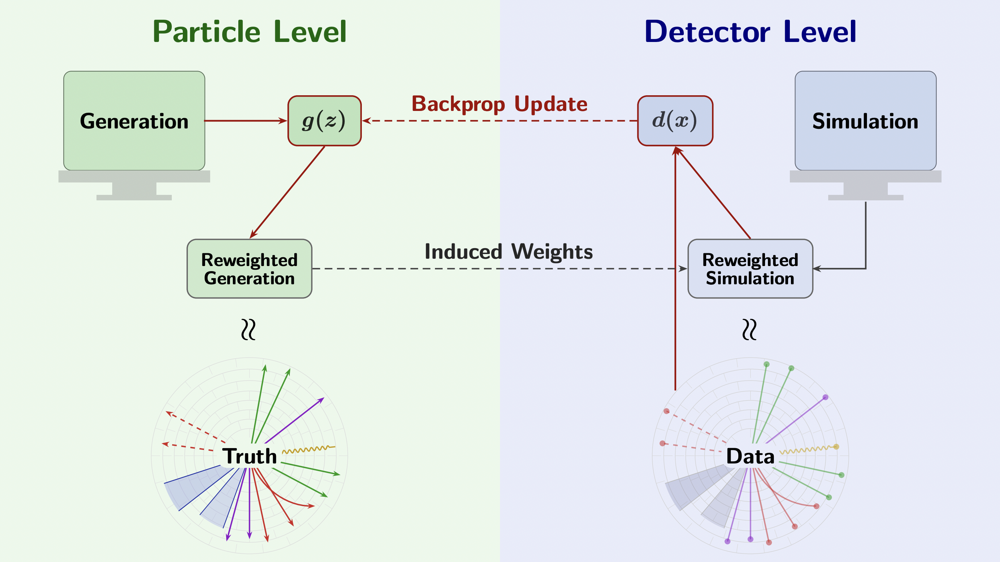
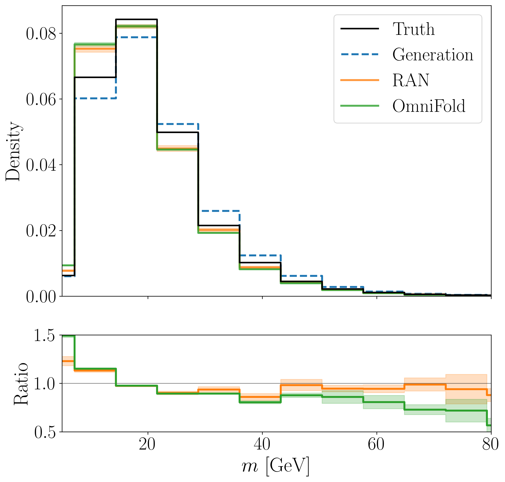
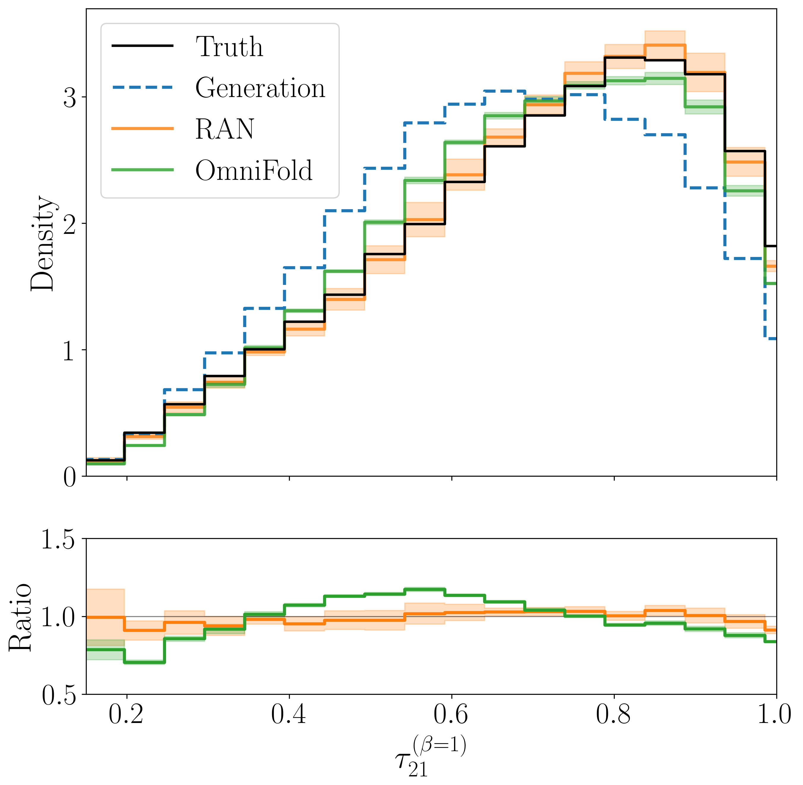
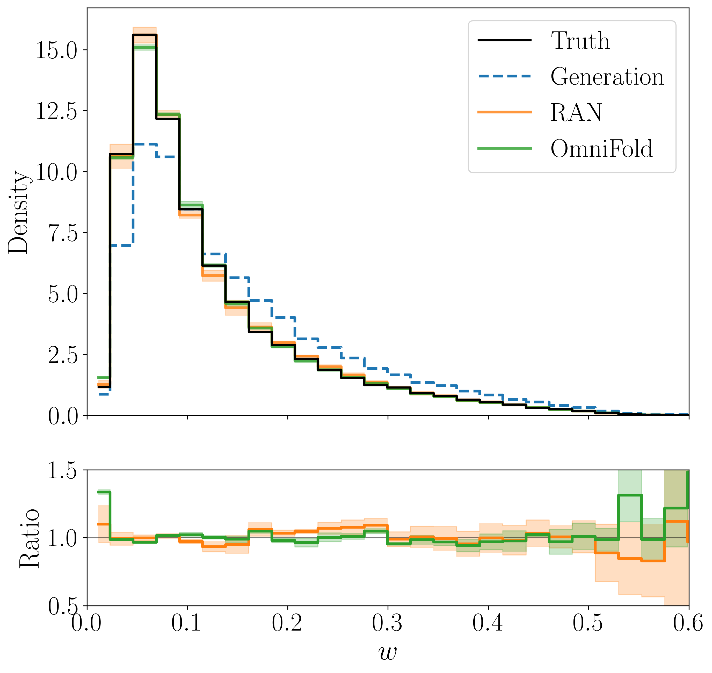
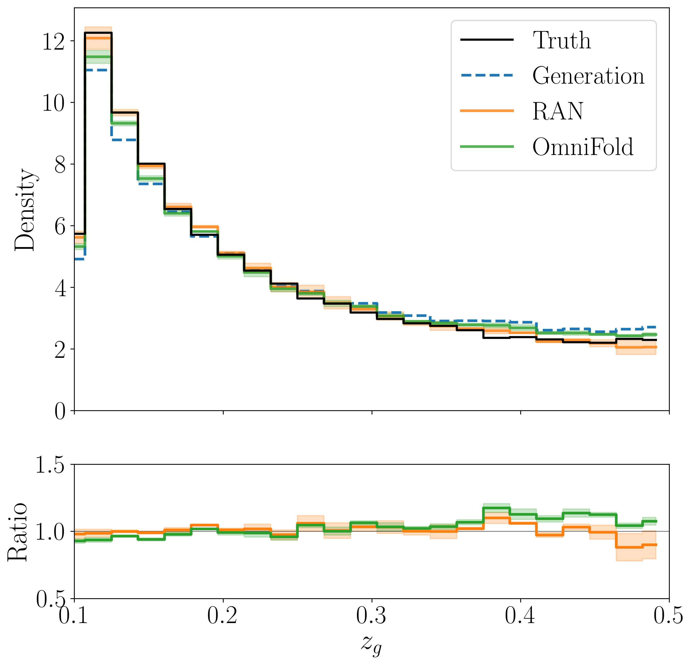

# Infinite Unfolding with Reweighting Wasserstein Adversarial Networks


<p align="center">
  
</p>


## Overview

This is the official Github repository accompanying the paper "Infinite Unfolding with Reweighting Wasserstein Adversarial Networks" that introduces RANs: a novel machine-learning based method for unbinned unfolding that does not require iterating nor overlapping support at the detector level. RANs generalize Moment Unfolding using a Wasserstein GAN-like setup.  

## Abstract

Differential cross sections are the currency of scientific exchange in particle and nuclear physics.  Recently, machine learning methods have enabled unbinned and high-dimensional cross section measurements through new approaches to unfolding.  A key challenge with unfolding is that it is a two-level optimization problem where constraints are available at the detector level while the target is at the particle level, linked by a stochastic detector response. Further complications arises when the particle-level and detector-level distributions have non-overlapping or only partially overlapping support, which can destabilize training and degrade unfolding performance. We introduce a new unbinned unfolding technique called the Reweighting Adversarial Network (RAN), a extension of the the Moment Unfolding protocol, inspired by the Boltzmann distribution, to accommodate full spectra. RANs address the two-level optimization problem through a particle-level reweighting function steered by a Wasserstein critic at the detector level. RANs do not require overlapping support at the detector level, nor multiple iterations. We evaluate RANs using Gaussian data and jet substructure experiments, including cases specifically designed to stress-test the method under vanishing support overlap. We demonstrate that RANs outperform state-of-the-art methods in accuracy and have a lower computational overhead.

## Key Highlighs


<p align="center">
  
  
</p>
<p align="center">
  
  
</p>

<p align="center">

| Observable | Generation | RAN | OmniFold |
|---|---|---|---|
| $m$ | 0.111 | **0.072** ± 0.005 | 0.116 ± 0.009 |
| $M$ | 0.258 | **0.024** ± 0.008 | 0.027 ± 0.006 |
| $w$ | 0.288 | **0.027** ± 0.005 | 0.014 ± 0.004 |
| $\tau_{21}$ | 0.254 | **0.032** ± 0.011 | 0.067 ± 0.004 |
| $z_g$ | 0.107 | **0.018** ± 0.005 | 0.060 ± 0.008 |
| $\ln \rho$ | 0.268 | 0.024 ± 0.007 | **0.015** ± 0.005 |

</p>

Wasserstein distance between the unfolded and true distributions predicted by RAN and OmniFold for the six substructure observables. Lower numbers indicate closer agreement with truth. The best score for each observable is indicated in boldface. Wasserstein distance between Generation and Truth is included as a baseline. The errors represent a one standard deviation interval obtained by bootstrapping.

## Repository Structure

```
.
├── run_comparison.py        # CLI entrypoint for training, evaluation, saving
├── prepare_data.py          # Downloads Pythia/Herwig data via EnergyFlow
├── requirements.txt         # Python dependencies
├── README.md
└── unfold/                  # Core library
    ├── __init__.py
    ├── observables.py       # Observable names, LaTeX labels, titles
    ├── models.py            # RANGenerator, RANCritic (nn.Module)
    ├── losses.py            # WGANCriticLoss, WGANGenLoss
    ├── data.py              # Data loading and normalization
    ├── ran.py               # RAN training loop (WGAN-GP)
    ├── omnifold.py          # OmniFold (DCTR classifiers, iterative push/pull)
    ├── ibu.py               # IBU (Richardson-Lucy / D'Agostini)
    ├── metrics.py           # Wasserstein distance, VLC divergence
    └── plotting.py          # Plotting utilities
```

## Quick Start

```bash
# Install dependencies
pip install -r requirements.txt

# Download and prepare data 
python prepare_data.py

# Run full comparison (20 runs, ~1 hour on GPU)
python run_comparison.py --data_file rawdata_omnifold.npz --device cuda

# Quick test (fewer epochs and runs)
python run_comparison.py --data_file rawdata_omnifold.npz --ran_epochs 50 --n_runs 2 --device cuda
```

## Outputs

All results are saved to `--output_dir` (default: `./jet_results/`):

| Output | Description |
|--------|-------------|
| `substructure.pdf` | Substructure distributions for all 6 observables |
| `histograms.npz` | Binned histograms for all runs (for re-plotting) |
| `full_distributions.npz` | Full unbinned truth-level distributions + raw per-event weights for RAN and OmniFold (all runs) |
| `ran_results.pkl` | Complete RAN results (weights, test arrays) per run |
| `of_results.pkl` | Complete OmniFold results per run |
| `ibu_results.pkl` | IBU unfolded histograms per run |
| `metrics.pkl` | Wasserstein distance and VLC divergence tables |

### Loading saved distributions

```python
import numpy as np

data = np.load('jet_results/full_distributions.npz', allow_pickle=True)

# RAN run 0
ran_weights = data['ran_run0_weights']
ran_mass    = data['ran_run0_m_herwig_gen']     # Herwig gen jet mass (to reweight)
truth_mass  = data['ran_run0_m_pythia_gen']     # Pythia gen jet mass (target)

# OmniFold run 0
of_weights  = data['of_run0_weights']
of_mass     = data['of_run0_m_herwig_gen']
```

## Command-line Options

```
--data_file       Path to prepared data file (default: rawdata_omnifold.npz)
--max_events      Max events per dataset (default: 150000)
--ran_epochs      RAN training epochs (default: 1000)
--of_niter        OmniFold iterations (default: 5)
--of_epochs       OmniFold classifier epochs (default: 10)
--ibu_niter       IBU iterations (default: 10)
--n_runs          Independent runs for error bars (default: 20)
--device          cuda or cpu (default: auto-detect)
--output_dir      Output directory (default: ./jet_results)
--skip_omnifold   Skip OmniFold
--skip_ibu        Skip IBU
```

